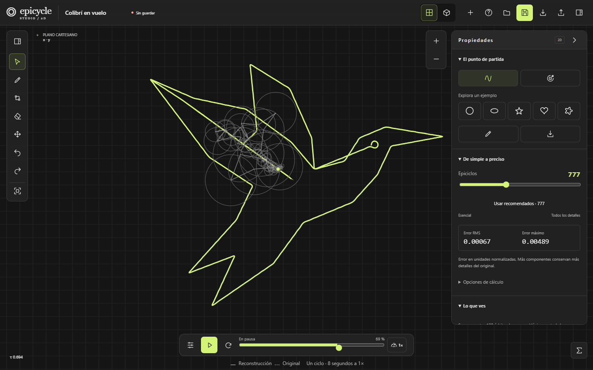
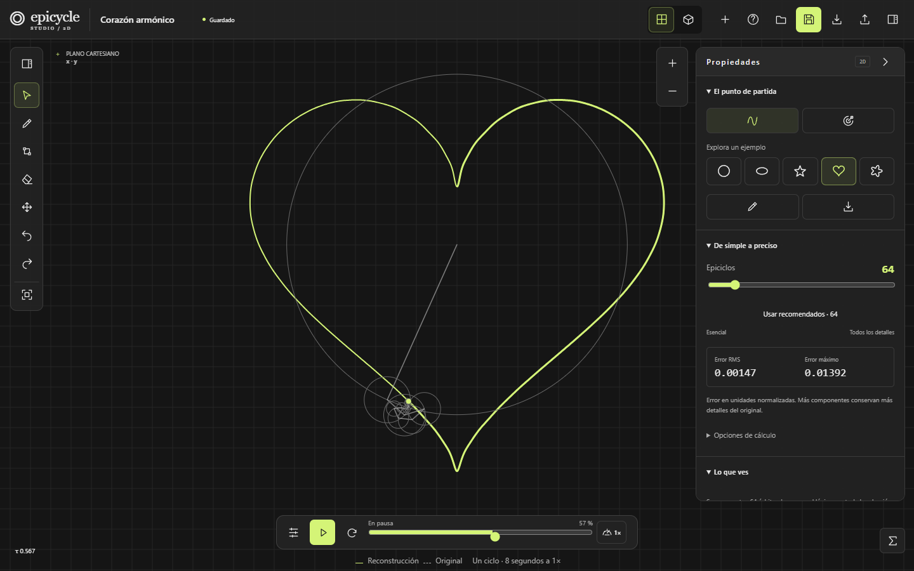
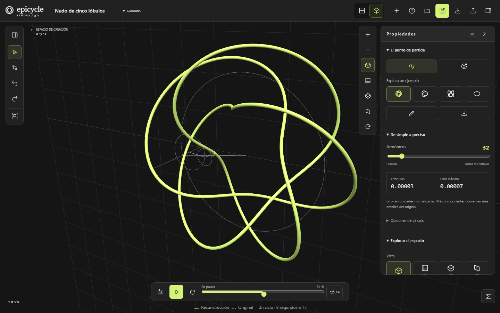
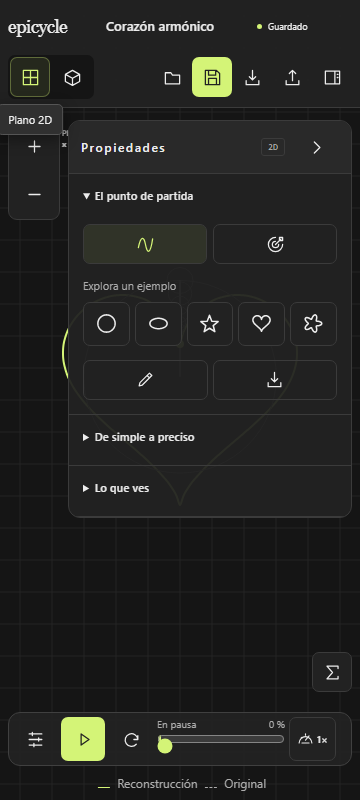

# Epicycle Studio

<p align="center">
  
</p>

## Video de funcionamiento

https://github.com/user-attachments/assets/59757a50-8833-4fca-b1d9-35a358555eb1

Reproducción 2D, galería, ajuste de epiciclos y vista 3D.

<p align="center">
  <strong>Dibuja cualquier cosa. Mira cómo la reconstruyen cientos de círculos girando.</strong><br>
  <a href="docs/learning.md">Guía de aprendizaje</a> ·
  <a href="docs/creation.md">Crear desde…</a>
</p>

## ¿Para qué sirve?

Epicycle Studio es un laboratorio gráfico que usa la **transformada de Fourier** para descomponer una curva en círculos que giran unos dentro de otros (epiciclos). Al sumarlos, la punta del último círculo recorre exactamente tu dibujo.

- **Aprender:** ver de forma directa qué es una serie de Fourier, qué aporta cada frecuencia y cómo cambia el error al usar más o menos círculos.
- **Crear:** convertir un dibujo a mano, un nombre, un SVG o una fotografía en una animación de epiciclos.
- **Exportar:** guardar PNG, SVG, video, proyecto JSON o una escultura 3D en GLB.

## Características

- **2D y 3D:** curvas planas o espaciales, con cámaras, edición numérica de puntos y tubo iluminado para esculturas.
- **Crear desde…:** galería de ilustraciones, texto (nombres y frases), SVG con varios trazos y fotografías convertidas a línea continua o contornos.
- **Dibujo libre** con varios trazos, edición de zonas del trazo y número de epiciclos recomendado automáticamente (hasta 2048).
- **Componer** tu propia máquina: añade círculos y edita radio, frecuencia, fase y centro.
- **Exportación** con vista previa: PNG, SVG, video, GLB, JSON y enlaces compartibles.
- **Color RGB animado**, fondo, cuadrícula, zoom y encuadres horizontal, cuadrado o vertical.
- **Accesible y responsive**, con atajos de teclado y diseño móvil.

## Cómo se usa

1. Abre el estudio 2D. Siempre inicia en pausa con un ejemplo ya calculado.
2. Pulsa **Reproducir** y mueve la línea temporal o la velocidad.
3. Cambia **Epiciclos** en el panel: pocos dan una forma suave; más conservan los detalles.
4. Pulsa **Limpiar lienzo** y elige **Dibujar** para trazar el tuyo. Puedes levantar el lápiz y continuar; los trazos se unen en orden y se cierra el ciclo.
5. Pulsa **+** (**Crear desde…**) para animar una ilustración, un texto, un SVG o una foto.
6. Abre **Componer** para añadir y ajustar círculos a mano.
7. Cambia a **Espacio 3D** para curvas espaciales, o usa **Llevar una copia a 3D** (el original se conserva).
8. **Guardar** crea una copia local. **Exportar y compartir** ofrece imagen, video, SVG, GLB, JSON y enlace.

Más detalle en la [guía de uso y aprendizaje](docs/learning.md) y en [Crear desde…](docs/creation.md).

## Ejecutar en local

Requiere Node 24.15.0 o una versión compatible con Angular 22.2.2 (ver `.nvmrc`).

```sh
npm ci
npm run start
```

Abre http://127.0.0.1:4200/studio/2d. Para el build de producción:

```sh
npm run build
npm run preview
```

## Verificación

```sh
npm run lint
npm run format:check
npm run test:ci
npm run build
node scripts/run.mjs playwright install
npm run test:e2e
```

La suite de navegador sirve el build real; Chromium, Firefox y WebKit están automatizados. WebKit en Windows no sustituye a Safari/iOS físico.

## Tecnología

Angular 22 (standalone, TypeScript estricto), Canvas 2D, Three.js, Web Workers, `fft.js`, IndexedDB y Zod. La matemática es pura e independiente de Angular y del render.

```
src/app/domain          Preparación de curvas, FFT, evaluación, errores y validación
src/app/infrastructure  Workers, IndexedDB, transferencia, SVG y fotos
src/app/features        Estado, reloj, historial, canvas, escena 3D, creador y aprendizaje
tests/e2e               Flujos de navegador (Playwright)
```

## Documentación

[Aprender y crear](docs/learning.md) · [Crear desde…](docs/creation.md)

## Capturas

| Escritorio                                                                        | 3D                                                                      | Móvil                                                                              |
| --------------------------------------------------------------------------------- | ----------------------------------------------------------------------- | ---------------------------------------------------------------------------------- |
| [](docs/screenshots/studio-desktop.png) | [](docs/screenshots/studio-3d.png) | [](docs/screenshots/studio-mobile.png) |
